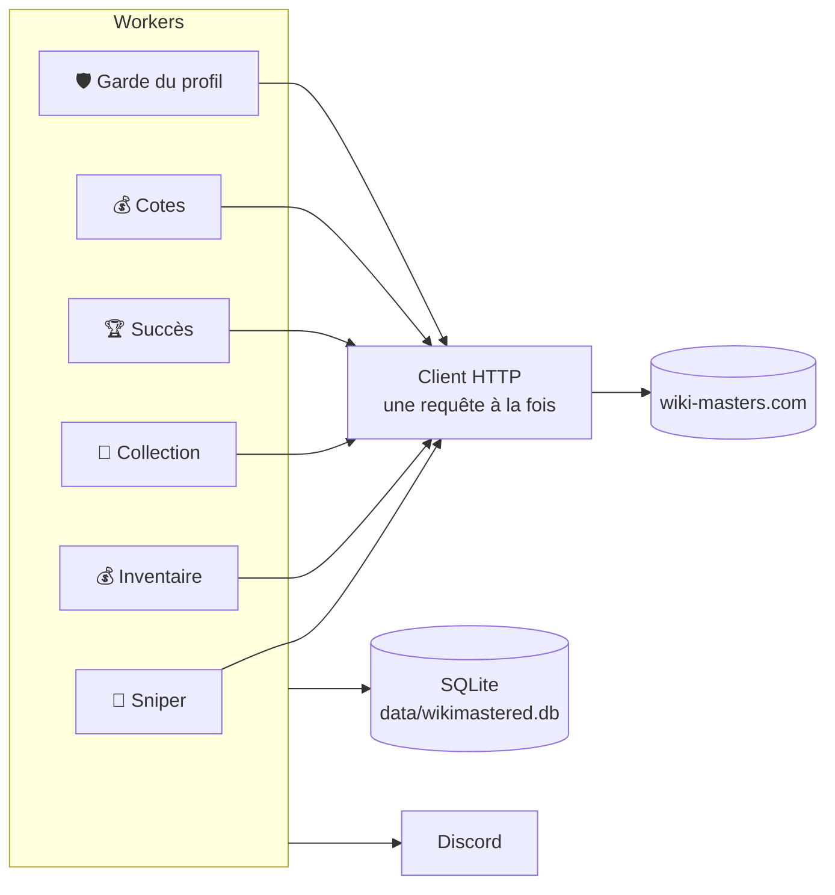
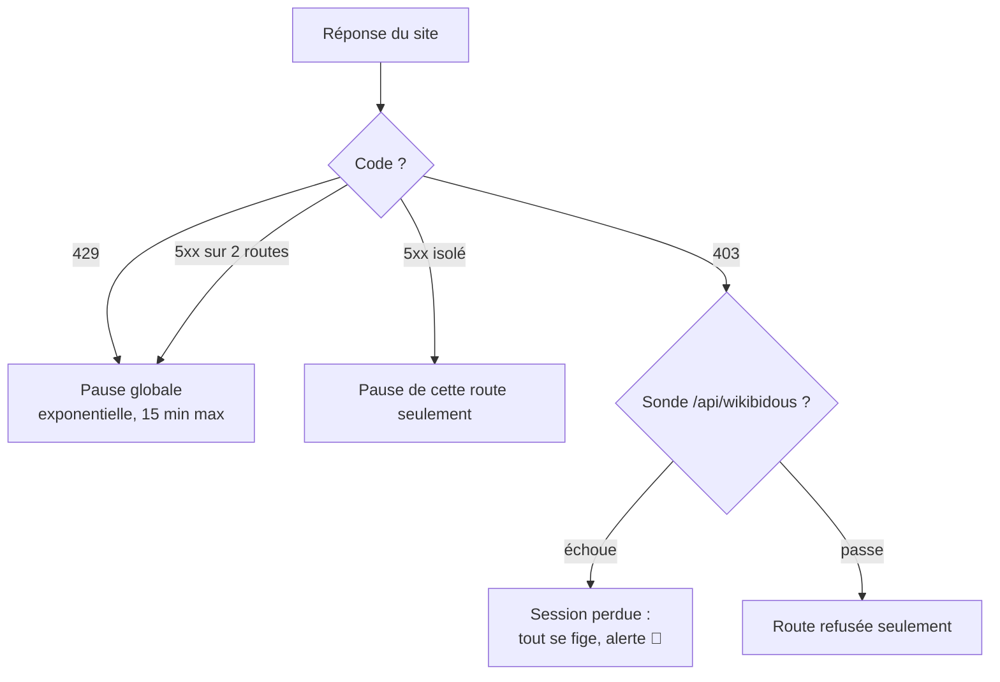
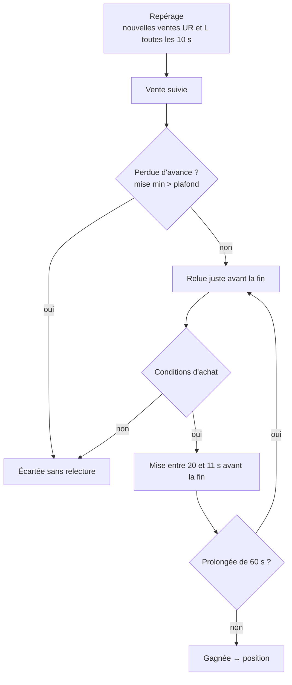
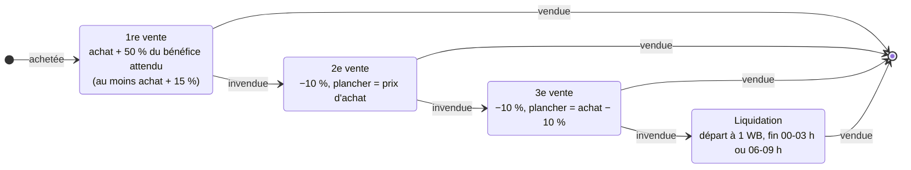
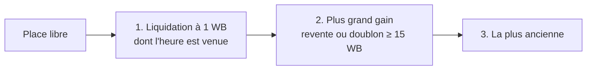
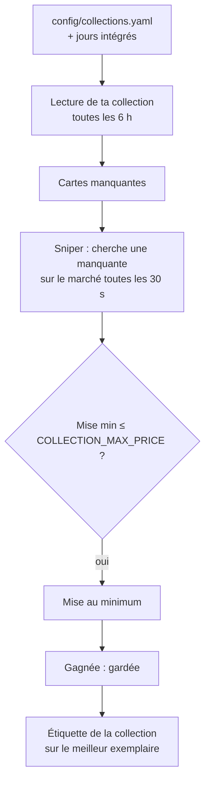
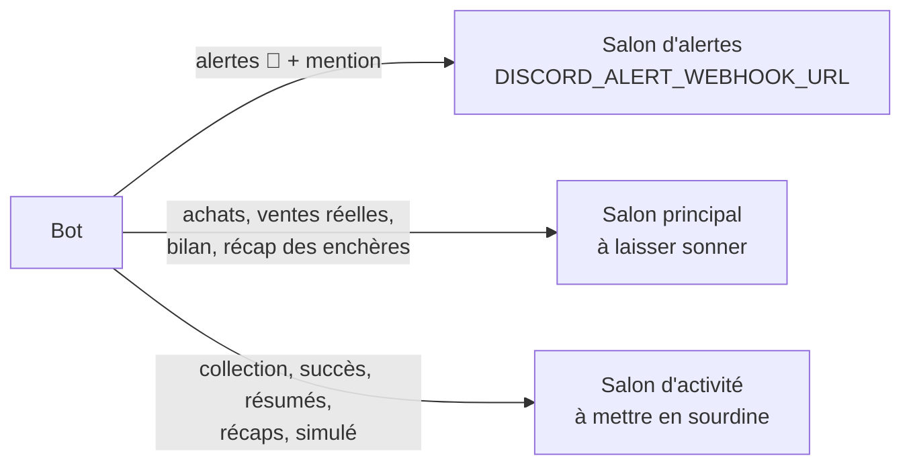

# Fonctionnement

Comment le bot décide. Chaque réglage cité est commenté dans [.env.example](../.env.example).

- [Vue d'ensemble](#vue-densemble)
- [Réseau](#réseau)
- [Sniper : acheter](#sniper--acheter)
- [Positions : revendre](#positions--revendre)
- [Inventaire : doublons et défausse](#inventaire--doublons-et-défausse)
- [Collections](#collections)
- [Cotes, succès, sécurité](#cotes-succès-sécurité)
- [Discord](#discord)
- [Routes et données](#routes-et-données)

## Vue d'ensemble

- Chaque worker tourne à part : une erreur n'arrête que lui. Il est relancé seul (30 s, puis de plus en plus espacé, 10 min au plus).
- Seules la perte de session, un 429 et une coupure réseau mettent tout le bot en pause.

## Réseau

Toutes les requêtes passent par une seule file :

| Moment | Écart entre deux requêtes |
|---|---|
| Normal | 1,5 s + aléa (`HTTP_MIN_SPACING_SECONDS`) |
| Pic de ventes, 09:00 → 02:00 | 1 s (`HTTP_PEAK_SPACING_SECONDS`) |
| Le site limite le bot pendant le pic | retour à 1,5 s pendant 30 min |

Une requête urgente (une mise) passe devant ; une requête de fond (cotes, lecture complète de la collection) passe après toutes les autres.

- **Une écriture n'est jamais rejouée.** Si sa réponse est perdue, elle est marquée « incertaine », puis le bot relit le résultat sur le site.
- **Session** : avec `SUPABASE_ANON_KEY`, le bot la renouvelle avant expiration (il lui faut sa propre session). Sinon, un nouveau cookie collé dans `data/session_cookie.txt` est repris en moins de 30 s.

## Sniper : acheter

Le site limite à **5 ventes simultanées**. Chaque achat est donc une « position » qui attend une de ces 5 places pour être revendue.

**Estimation d'une carte** : médiane des 5 dernières ventes observées par le bot, plafonnée par la moyenne du site. Ne comptent pas :
- une vente 3 fois au-dessus ou au-dessous de la médiane ;
- une vente entre deux joueurs qui ont déjà fait affaire ;
- une vente sans concurrence (elle ne peut pas faire monter l'estimation).

**Conditions d'achat**

| Condition | Valeur |
|---|---|
| Ventes observées | ≥ 3 disputées parmi les 5 dernières |
| Écart des prix observés | plus haute ≤ 2 × plus basse |
| Budget d'une position | capital × 0,9 / 5 (~540 WB pour 3 000) |
| Bénéfice attendu | ≥ 25 % du budget (50 % si la position doit attendre une place) |
| Mise / estimation | entre 40 % et 70 % (80 % la nuit, 02:00 → 07:30) |
| Revente estimée | ≤ la vente concurrente la moins chère |
| Positions | 15 au plus, dont 10 en attente d'une place |

**Mise** : le minimum du site + la moitié de l'écart jusqu'au plafond. Surenchérie, le bot va droit au plafond, une seule fois. Il ignore toute carte sur laquelle tu mises toi-même.

## Positions : revendre

Une carte gagnée est mise en vente dès son arrivée, pour 12 h s'il y a moins de 5 positions, sinon pour 6 h. Si cette durée la ferait finir à une heure où les L se vendent mal (11-13 h, 18-22 h), le bot prend l'autre durée quand elle finit mieux. La durée est revue au moment de publier, pour une carte qui a attendu une place. Au moment de publier, le bot se place juste sous la vente concurrente la moins chère, jamais sous le plancher.

Les L parties à 1 WB à ces heures-là se sont vendues autour de leur prix habituel (du 15 au 26/10).

**Étiquette « revente »** (`MANUAL_RESALE_TAG`) : une carte que tu achètes ou tires toi-même et que tu étiquettes est reprise comme une position, avec les mêmes règles. Sans achat retrouvé (carte d'un paquet), son prix d'achat est 0 et elle part à sa cote.

## Inventaire : doublons et défausse

Toutes les 10 min, le bot regarde s'il reste une place de vente (tes ventes manuelles comptent). Une place libre va, dans l'ordre :

**Jamais vendu ni défaussé**

| Protégé | Exception |
|---|---|
| Dernier exemplaire de chaque carte | raretés de `SELL_LAST_COPY_RARITIES` (jamais une carte achetée par le bot) |
| Favoris, shiny | — |
| Étiquettes de `PROTECTED_TAGS` | — |
| Engagé dans un échange, déjà en vente | — |

**Défausse** (`AUTO_DISCARD`) : les doublons, plus les derniers exemplaires des raretés de `DISCARD_LAST_COPY_RARITIES` (ex. `C,PC`) s'ils sont déjà cotés et ne se sont jamais vendus au-dessus de `DISCARD_MAX_VALUE`. Elle ne fait jamais repasser la collection sous un palier de succès atteint.

## Collections

- Seuls les titres exacts comptent : « 14 octobre », pas « 14 octobre 1066 ».
- Jamais deux enchères sur la même carte, jamais sur une carte que tu cherches toi-même.
- Chaque vérification anti-bot laisse passer ~10 mises : la collection n'en prend que 2 (`COLLECTION_BIDS_PER_CHECK`), le reste va aux L.
- Les jours seuls se lisent en 12 recherches (une par mois). Avec une collection du fichier, toute la collection est lue, en requêtes de fond.
- `python -m src.main collection` montre l'avancement et les cartes manquantes.

## Cotes, succès, sécurité

**Cotes** (toutes les 12 h, en requêtes de fond, sans message) : cote chaque carte, pour savoir quels derniers exemplaires défausser.

| Carte | Recotée après |
|---|---|
| Jamais cotée | en premier, les plus vues sur Wikipédia d'abord |
| Cotée | 7 jours |
| Jamais vendue | 30 jours |
| Cotée sous 50 WB | jamais |

**Succès** : chaque soir à 22:50, le bot fait recalculer tes succès et réclame les récompenses.

**Garde du profil** : toutes les 15 min, le bot relit ton profil. Au premier avertissement de triche ou à la première sanction, il s'arrête net, même après un redémarrage, jusqu'à `rm data/HALT`.

## Discord

| Message | Quand | Contenu |
|---|---|---|
| 🩺 Récap | toutes les 4 h | ce que chaque worker a fait ; orange avec « À vérifier » en cas d'anomalie |
| Récap des enchères | 08:00 | toutes les mises sur 24 h, gain réalisé et manqué |
| Bilan | 23:00 | solde, puis sniper, ventes, positions, collection |

## Routes et données

**Routes** : aucune n'est inventée. Elles viennent des extensions communautaires ([WikiMastersTools](https://github.com/qkerman/WikiMastersTools-kzfamily), [WikiRemastered](https://github.com/Lypningeuh/WikiRemastered), [wikimasters-farm](https://github.com/3d3n-pyc/wikimasters-farm), [wikimasters-bot](https://github.com/LockBlock-dev/wikimasters-bot)) et sont décrites dans [config/endpoints.yaml](../config/endpoints.yaml).

| Besoin | Commande |
|---|---|
| Corriger une route | `python -m src.tools.parse_curl --name place_bid --write < requete.curl` (écrit `config/endpoints.local.yaml`) |
| Découvrir une route | `python -m src.tools.browser_login --record`, puis naviguer : les appels vont dans `data/inspect/capture/` |

**Données** : le volume `data/` contient la base SQLite, `logs/bot.log`, la session et le `heartbeat` du healthcheck. Après chaque bilan, les cotes et ventes observées de plus de 60 jours sont purgées. Le plus haut prix de chaque carte est gardé.
