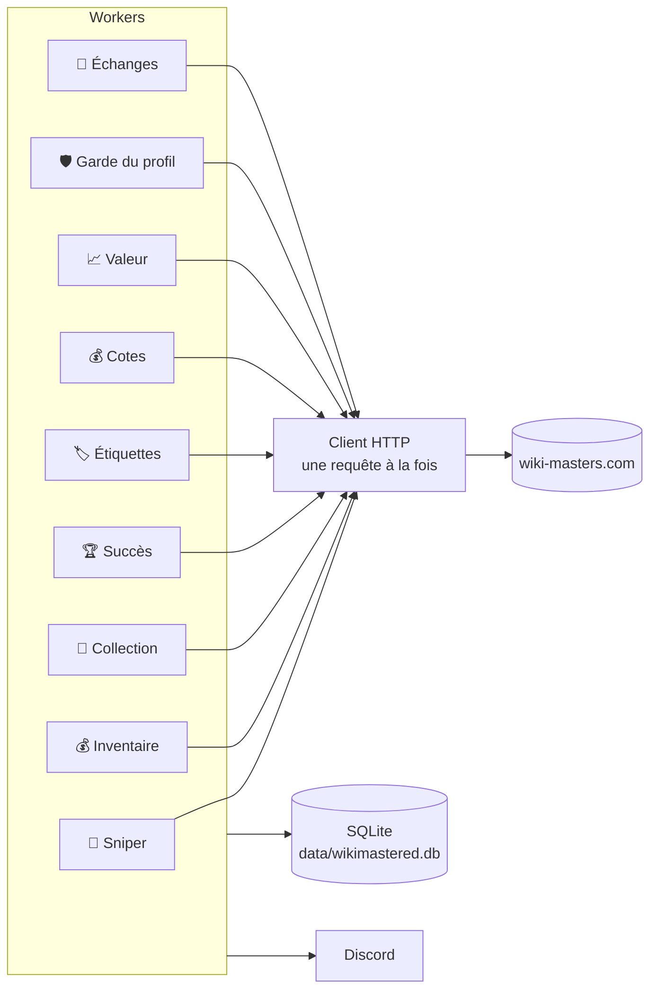
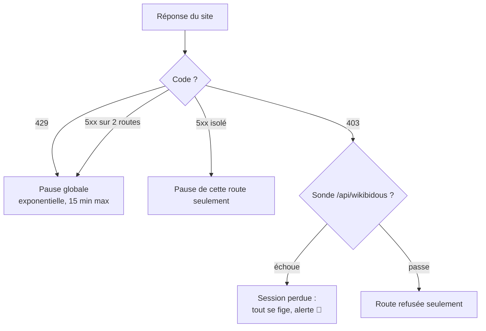
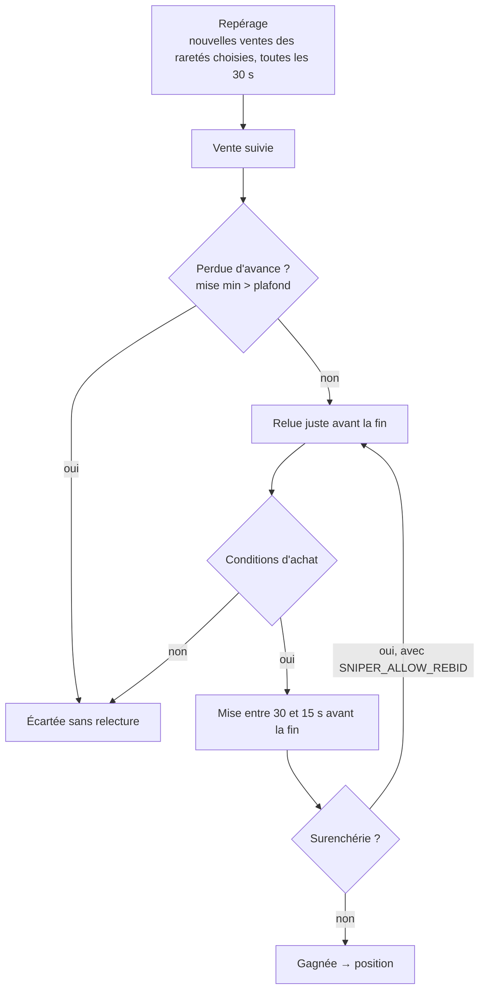
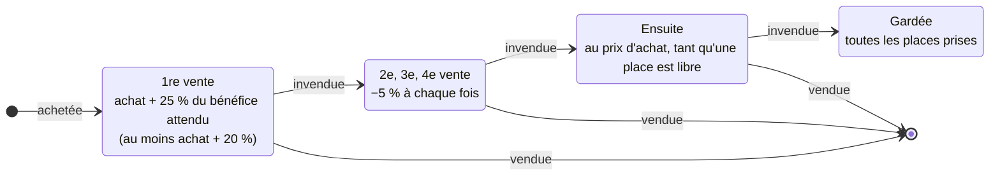
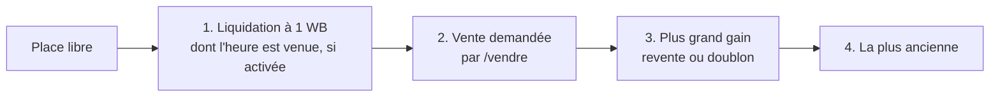
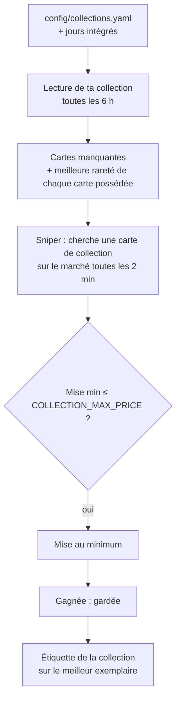
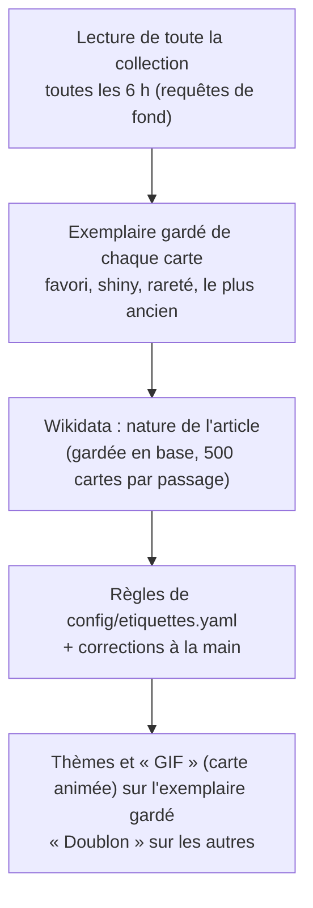
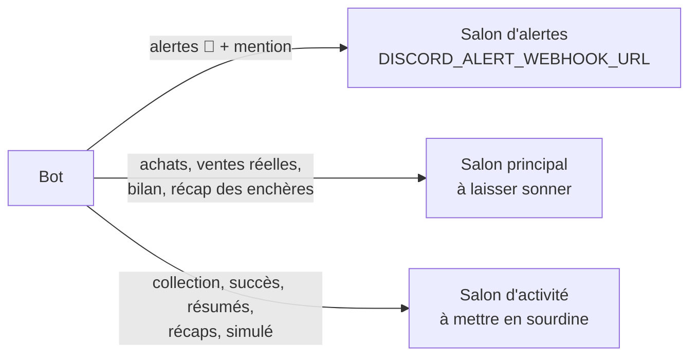

# Fonctionnement

Comment le bot décide. Les valeurs citées sont celles par défaut : volontairement prudentes, elles n'ont pas été optimisées. Chaque réglage cité est commenté dans [.env.example](../.env.example).

- [Vue d'ensemble](#vue-densemble)
- [Réseau](#réseau)
- [Sniper : acheter](#sniper--acheter)
- [Positions : revendre](#positions--revendre)
- [Inventaire : doublons et défausse](#inventaire--doublons-et-défausse)
- [Collections](#collections)
- [Étiquettes de thème](#étiquettes-de-thème)
- [Cotes, succès, sécurité](#cotes-succès-sécurité)
- [Discord](#discord)
- [Logs et journal](#logs-et-journal)
- [Routes et données](#routes-et-données)

## Vue d'ensemble

- Chaque worker tourne à part : une erreur n'arrête que lui. Il est relancé seul (30 s, puis de plus en plus espacé, 10 min au plus).
- Seules la perte de session, un 429 et une coupure réseau mettent tout le bot en pause.

## Réseau

Les lectures de tous les workers passent par une file commune, qui fixe le débit maximal :

| Moment | Écart entre deux lectures |
|---|---|
| Normal | 1,5 s + aléa (`HTTP_MIN_SPACING_SECONDS`) |
| Pic de ventes, 09:00 → 02:00, si `HTTP_PEAK_SPACING_SECONDS` est renseigné | cet écart |
| Le site limite le bot pendant le pic | retour à l'écart normal pendant 30 min |

Une relecture urgente (juste avant une mise) passe devant ; une requête de fond (cotes, lecture complète de la collection) passe après toutes les autres.

Chaque worker peut en plus avoir son propre écart entre deux de ses lectures (`HTTP_WORKER_SPACING_SECONDS=cotes=5,etiquettes=3`, ou en JSON ; vide ou `0` : aucun). Un worker absent de la liste n'a que la file commune : on y laisse le sniper, qui prend les créneaux libérés par les autres.

Les écritures (mises, ventes, étiquettes…) ont leur propre file, une toutes les `HTTP_WRITE_SPACING_SECONDS` (1 s), et ne passent jamais derrière les lectures.

Le récap affiche le bloc « 🌐 Réseau » : lectures par worker, débit moyen, écritures et limitations du site depuis le récap précédent.

- **Une écriture n'est jamais rejouée.** Si sa réponse est perdue, elle est marquée « incertaine », puis le bot relit le résultat sur le site.
- **Session** : avec `SUPABASE_ANON_KEY`, le bot la renouvelle avant expiration (il lui faut sa propre session). Sinon, un nouveau cookie collé dans `data/session_cookie.txt` est repris en moins de 30 s.

## Sniper : acheter

Le site limite à **5 ventes simultanées**. Chaque achat est donc une « position » qui attend une de ces 5 places pour être revendue.

**La revente est coupée par défaut** : tant que `SNIPER_RESALE_RARITIES` est vide, le bot n'achète rien pour revendre et n'observe aucune vente.

Une mise dans les 10 dernières secondes prolonge l'enchère de 60 s : le bot n'y mise jamais.

**Estimation d'une carte** : médiane des 7 dernières ventes observées par le bot, à rareté égale, plafonnée par la moyenne du site. Un shiny n'est estimé que sur ses propres ventes : la moyenne du site ne le distingue pas. Ne comptent pas :
- une vente 3 fois au-dessus ou au-dessous de la médiane ;
- une vente entre deux joueurs qui ont déjà fait affaire ;
- une vente sans concurrence (elle ne peut pas faire monter l'estimation).

**Conditions d'achat**

| Condition | Valeur |
|---|---|
| Ventes observées | ≥ 4 disputées parmi les 7 dernières ; ≥ 8 ventes pour un shiny |
| Écart des prix observés | plus haute ≤ 1,5 × plus basse |
| Budget d'une position | capital × 0,5 / 5 (~300 WB pour 3 000), 500 WB au plus (`SNIPER_MAX_BID`) |
| Bénéfice attendu | ≥ 50 % du budget, 100 WB au moins |
| Bénéfice si la position doit attendre une place | ≥ 100 % du budget, sauf si elle rapporte plus que les ventes en attente : elle passe alors devant elles |
| Mise / estimation | entre 25 % et 50 % |
| Revente estimée | ≤ la vente concurrente la moins chère, encore en cours 1 h après la fin de l'enchère et affichée à au moins 50 % de l'estimation |
| Solde | jamais sous 50 WB (`SNIPER_MIN_BALANCE_RESERVE`) |
| Positions | 5 au plus (`PORTFOLIO_MAX_POSITIONS`, 0 = aucun plafond) |

**Mise** : le minimum du site. `SNIPER_BID_PUSH` la pousse vers le plafond, et `SNIPER_ALLOW_REBID=true` remise au plafond, une seule fois, si elle est surenchérie. Le bot ignore toute carte sur laquelle tu mises toi-même.

## Positions : revendre

Une carte gagnée est mise en vente dès son arrivée, pour 6 h (`POSITION_LIST_DURATION_MINUTES`). Au moment de publier, le bot se place juste sous la vente concurrente la moins chère, jamais sous le plancher. Une concurrente affichée sous 50 % de l'estimation ne compte pas : c'est un prix de départ, qui montera. Un seul exemplaire d'une carte est en vente à la fois.

Le prix baisse avec le temps passé en vente sans acheteur, d'une étape toutes les 6 h (`POSITION_STEP_MINUTES`). L'attente d'une place de vente ne compte pas. Le bot ne descend jamais sous le prix d'achat.

- **Liquidation** (coupée par défaut, `POSITION_FIRE_SALE_AFTER`) : après N étapes, la carte repart à 1 WB, avec une fin à 00-03 h ou 06-09 h.
- **Perte permise** (coupée par défaut, `POSITION_MAX_LOSS`) : après `POSITION_LOSS_AFTER` étapes, le prix peut passer sous le prix d'achat.
- **Position chère** (coupée par défaut, `POSITION_EXPENSIVE_*`) : moins de baisses et une liquidation plus tôt pour une carte achetée à partir de ce prix.
- **Position qui traîne** : détenue depuis plus de 48 h (`POSITION_STALE_HOURS`), elle déclenche une alerte avec des boutons.
- **Reventes plus longues** : avec `POSITION_LIST_LONG_BELOW=N`, une revente dure `POSITION_LIST_LONG_MINUTES` tant que moins de N positions sont détenues, sauf si elle finirait à une heure de `POSITION_AVOID_END_HOURS`.

**Étiquette « revente »** (`MANUAL_RESALE_TAG`) : une carte que tu achètes ou tires toi-même et que tu étiquettes est reprise comme une position, avec les mêmes règles. Sans achat retrouvé (carte d'un paquet), son prix d'achat est 0 et elle part à sa cote.

## Inventaire : doublons et défausse

Toutes les 30 s, le bot publie ce qui attend s'il reste une place de vente (tes ventes manuelles comptent). Une place libre va, dans l'ordre :

**Doublons** (`AUTO_LIST`) : toutes les 10 min, les doublons les mieux cotés, à partir de 15 WB (`SELL_MIN_VALUE`), rejoignent cette file, 5 en attente au plus.

**Jamais vendu ni défaussé**

| Protégé | Exception |
|---|---|
| Dernier exemplaire de chaque carte | raretés de `SELL_LAST_COPY_RARITIES` (jamais une carte achetée par le bot) |
| Favoris, shiny | — |
| Étiquettes de `PROTECTED_TAGS` | — |
| Engagé dans un échange, déjà en vente | — |

**Défausse** (`AUTO_DISCARD`) : les doublons, plus les derniers exemplaires des raretés de `DISCARD_LAST_COPY_RARITIES` (ex. `C,PC`) s'ils sont déjà cotés et ne se sont jamais vendus au-dessus de `DISCARD_MAX_VALUE` (2 WB). Elle ne fait jamais repasser la collection sous un palier de succès atteint (`ACHIEVEMENT_MILESTONES`). Sans paliers renseignés, aucune défausse n'a lieu, par prudence ; `ACHIEVEMENT_MILESTONES=0` indique qu'il n'y en a aucun à protéger.

## Collections

Une collection est une liste de titres Wikipédia à posséder. Le bot mise sur les cartes manquantes (jusqu'à `COLLECTION_MAX_PRICE`, 10 WB), les garde et leur pose une étiquette. `COLLECTION_SETS` choisit celles qui sont actives ; vide, aucune ne l'est.

| Collection | Contenu |
|---|---|
| `jours` | Les 366 jours de l'année, intégrés au code |
| `gifs` | Les articles dont l'image principale est un GIF animé ([liste](../config/gifs_animes.txt)) |
| la tienne | À décrire dans [config/collections.yaml](../config/collections.yaml) : un nom, une étiquette, les titres |

`COLLECTION_TITLES` ajoute des titres isolés. Pour protéger les cartes gagnées, ajoute leur étiquette à `PROTECTED_TAGS`.

- Rareté (`COLLECTION_UPGRADE`, coupé par défaut) : une carte possédée est aussi misée quand une vente propose une rareté plus haute que ta meilleure (R → SR, SR → UR…), au même plafond `COLLECTION_MAX_PRICE`. Les recherches alternent : une carte manquante, puis une carte à monter.
- L'étiquette passe sur le nouvel exemplaire, puis est retirée de l'ancien, qui n'est plus protégé : il peut être vendu ou défaussé.
- Seuls les titres exacts comptent : « 14 octobre », pas « 14 octobre 1066 ».
- Jamais deux enchères sur la même carte, jamais sur une carte que tu cherches toi-même.
- Chaque vérification anti-bot laisse passer ~10 mises : la collection n'en prend que 2 (`COLLECTION_BIDS_PER_CHECK`), le reste va aux L.
- Les jours seuls se lisent en 12 recherches (une par mois). Avec une collection du fichier, toute la collection est lue, en requêtes de fond.
- `python -m src.main collection` montre l'avancement et les cartes manquantes.

## Étiquettes de thème

- Désactivé par défaut : `ENABLE_THEME_TAGS=true`. Écritures du groupe `themes` : `SIMULATE=themes` pour voir dans les logs ce qui serait posé (`[SIMULÉ]`), sans rien écrire.
- Une carte peut avoir plusieurs thèmes (Personne + Musique). Pour les personnes, la description Wikidata fait foi (« actrice et chanteuse »), pas la liste complète des métiers. `sauf` ne retire pas un thème trouvé par la description ou le métier : une « actrice et écrivaine » a les deux.
- Le bot ne retire que « Doublon », de l'exemplaire gardé quand son doublon est parti, « GIF » (ligne suivante) et les thèmes marqués `retirer` dans le fichier (« Objet ») : d'une carte qui n'a plus ce thème, seulement une fois un autre de ses thèmes posé.
- « GIF » (`THEME_GIF_TAG`) va sur l'exemplaire gardé d'une carte vraiment animée (plus d'une image, nombre lu sur Wikipédia) et est retirée de tous les autres. Avec `PROTECTED_TAGS`, la carte de la collection `gifs` est protégée et ses doublons restent à vendre.
- La vente et la défausse prennent toujours l'exemplaire le plus récent, et l'exemplaire gardé est le plus ancien : un exemplaire « Doublon » part avant l'exemplaire gardé.
- Chaque étiquette est à créer une fois sur le site. Les noms sont comparés sans émojis ni casse, partout dans le bot (`PROTECTED_TAGS`, `MANUAL_RESALE_TAG`, `COLLECTION_TAG`) : « 📅 Jour » correspond à `Jour`.
- Aucune mise, aucun paquet : rien ne compte pour la vérification anti-bot. Wikidata est un autre site.
- `python -m src.main etiquettes` montre le classement, les cartes sans thème et les étiquettes à créer, sans rien écrire.

## Cotes, succès, sécurité

**Cotes** (toutes les 12 h, en requêtes de fond, sans message) : cote chaque carte, pour savoir quels derniers exemplaires défausser.

| Carte | Recotée après |
|---|---|
| Jamais cotée | en premier, les plus vues sur Wikipédia d'abord |
| Cotée | 7 jours |
| Jamais vendue | 30 jours |
| Cotée sous 50 WB | jamais |

**Succès** (avec `SUPABASE_ANON_KEY`) : chaque soir à 22:50, le bot fait recalculer tes succès et réclame les récompenses.

**Échanges** : toutes les 10 min, le bot relit les échanges en cours. Chaque échange qu'on te propose (contre-offres comprises) est annoncé une fois dans le salon principal : valeur de chaque carte (médiane des ventes observées sur 7 jours, même rareté, shiny à part), nombre de ventes de la semaine, verdict (équitable à 10 % près) et, s'il est défavorable, la contre-offre à envoyer : des WB en plus, une carte de la bonne valeur qui part vite, ou une de tes cartes retirée. Le bot ne répond jamais à ta place. `/echange` fait la même évaluation pour un échange que tu envisages.

**Garde du profil** (avec `SUPABASE_ANON_KEY`, sinon une alerte le signale au démarrage) : toutes les 15 min, le bot relit ton profil. Au premier avertissement de triche ou à la première sanction, il s'arrête net, même après un redémarrage, jusqu'à `rm data/HALT`. La même lecture prévient quand `PACKS_ALERT_AT` paquets attendent d'être ouverts (stock calculé depuis la dernière régénération, message unique jusqu'à ce qu'il redescende) ; le bot ne les ouvre jamais.

## Discord

Avec `DISCORD_WEBHOOK_SNIPER`, `_VENTES`, `_COLLECTION`, `_BILAN` et `_SYSTEME`, chaque catégorie a son salon (sauf les alertes critiques, toujours dans le salon d'alertes) ; une catégorie sans salon suit le schéma ci-dessus.

**#alertes, le seul salon à laisser sonner** : il reçoit les alertes critiques en entier (avec la mention), et une copie courte, sans mention, de chaque avertissement qui demande une action (position qui traîne, revente abandonnée, carte en favori, sauvegarde impossible, erreurs répétées…) et de chaque échange reçu, avec un lien vers le salon du message complet et de ses boutons. Ce qui se règle seul (serveurs instables, route limitée) et l'arrêt du bot au redéploiement n'y vont pas.

**Code couleur**, le même pour tous les messages (salons, commandes, graphiques ; `src/core/colors.py`) : 🔵 information, 🟢 tout va bien, gain ou réglage activé, 🟠 à surveiller, 🔴 problème ou perte, ⚪ réglage coupé, annulé ou rien à faire.

Chaque position a **un seul message**, dans #ventes : créé à l'achat (carte, prix, revente visée), modifié à chaque étape (en vente, sans acheteur et remise en vente, à 1 WB…), et republié en bas du salon quand elle est vendue ou qu'un problème demande ton attention (Discord ne signale pas une modification). Les boutons (changer le prix, brader, garder) sont ceux de la dernière étape. Les mises du sniper n'ont pas de message propre : le récap des enchères de 08:00 et `/sniper` en donnent le détail (`NOTIFY_EACH_BID=true` : un message par mise).

| Message | Quand | Contenu |
|---|---|---|
| 🩺 Récap | toutes les 4 h | ce que chaque worker a fait ; orange avec « À vérifier » en cas d'anomalie |
| Récap des enchères | 08:00 | toutes les mises sur 24 h, gain réalisé et manqué |
| Bilan | 23:00 | solde, puis sniper, ventes, positions, collection |

## Logs et journal

| Où | Contenu | Lecture |
|---|---|---|
| Console (logs du conteneur) | une ligne courte par événement, au niveau `LOG_LEVEL` ; source courte (`sniper`, `reseau`, `discord`…) ; les messages Discord y sont recopiés sans mise en forme | `docker logs --since 2h wikimastered` |
| Relevé `stats` | toutes les 15 min (`STATS_MINUTES`) : passages de chaque worker (nombre, durée moyenne, p95, max, erreurs), temps du sniper par étape, requêtes au site (débit, échecs, attente d'un créneau par worker, latence des routes les plus appelées) ; le dernier est aussi dans `/etat` | console |
| Journal `data/logs/journal.jsonl` | tout, DEBUG compris, une ligne JSON par entrée ; plus les événements `stats` (détail par route) et `enchere` (chaque nouvelle issue d'une enchère examinée par le sniper : mise minimale, estimation, ventes, issue) ; un fichier par jour, `JOURNAL_KEEP_DAYS` gardés | `python -m src.main journal --since 6h [--ev stats,enchere] [--events]` |

## Routes et données

**Routes** : aucune n'est inventée. Elles viennent des [extensions communautaires](../README.md#crédits) et sont décrites dans [config/endpoints.yaml](../config/endpoints.yaml). Si le site change : [corriger ou ajouter une route](DEVELOPPEMENT.md#corriger-ou-ajouter-une-route).

**Données** : le volume `data/` contient la base SQLite, le journal `logs/journal.jsonl`, la session et le `heartbeat` du healthcheck. Après chaque bilan, les cotes et ventes observées de plus de 60 jours sont purgées. Le plus haut prix de chaque carte est gardé.
